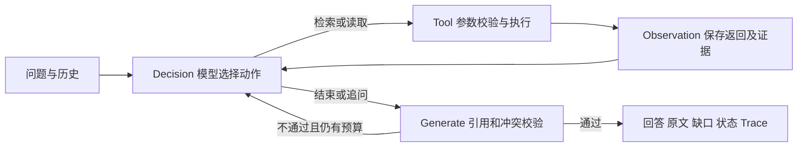

# 方案

## 调用流程

输入问题与可选历史后，创建单轮AgentState；历史用于理解指代和保留原始任务，不直接充当证据。流程为：

Decision接收本轮问题、历史、工具观察、校验反馈和剩余预算，输出结构化动作。Tool只执行模型选择的工具；Observation保存实际结果后交回模型。Generate检查引用存在、完整句匹配、适用范围及冲突双方读取情况，再生成正文。

检索使用中文双字词/英文数字token、同义词扩展及BM25排序，默认top_k=5、上限8；摘要最多100字符，read_document返回完整原文。关联版本编号供模型继续读取，不代替版本优先级判断。

默认每轮最多10次模型决策、7次工具调用。协议错误、JSON解析或截断可以在预算内反馈重试；模型连接失败、工具持续异常或预算耗尽时返回incomplete。Trace保存公开行动摘要，不保存隐藏推理或鉴权信息。

## 动态决策

模型可自主选择search_documents、read_document、clarify或finish。每次工具执行后重新调用模型，检索次数、查询改写、原文读取顺序及结束时机不按场景预编排。离线ScriptedModel只提供流程回归脚本，真实模式不会自动降级为Mock。

存在相同事项、范围重叠且无明确替代关系的不同规定时，程序要求冲突双方读取及引用；日期不决定优先级。额外的非冲突引用可以来自已观察的完整检索句，不强制全部重复读取。校验失败会明确返回相关文档编号，让模型决定下一动作。

多轮用户纠正信息以最新明确陈述为准。有限用户陈述账本辅助处理身份、一晚住宿和金额，不采纳助手历史中的自述。只有明确用户金额、单位及实际制度原文时才作限定的住宿金额比较；比较未超上限不等于最终一定可报销。

混合问题逐项核对：已支持部分引用原文，未知部分列入missing_info。整体未完全解决时可返回insufficient并标记coverage=partial；真正缺少可补充的适用条件时向用户澄清。实时外部数据缺少工具时说明不足，不能追问后暗示可以查询。

## 技术取舍

实现版本为0.1.0，采用Python标准库的精简同步状态循环，语法要求Python 3.11+，实际验证CPython 3.14.0；没有引入外部Agent框架。graph/state管理闭环与状态，model/schema负责模型接入及动作格式，nodes划分四节点，retrieval负责资料工具，context辅助用户陈述，evaluation负责验证与记录。

| 选择 | 原因与代价 |
|---|---|
| 标准库状态循环 | 安装简单、节点职责可解释；不提供框架级持久化或并发调度 |
| JSON资料与BM25 | 无需向量库和embedding服务；中文改写召回依赖有限词法及模型补查 |
| HTTPS Chat Completions与严格JSON Schema | 模型配置集中、协议可校验；不同服务兼容性仍需实测 |
| 完整原文句引用及条件金额比较 | 便于核查、避免另一个自由摘要；回答表达较机械，无法证明全部语义适用性 |
| policy_key/scope/supersedes | 让同事项版本关系可检查；依赖元数据，可能误报或漏掉隐含冲突 |
| 有限身份模式与执行预算 | 降低旧身份污染及无限循环风险；不能覆盖全部中文表达或消除连接失败 |

真实调用已验证方舟2.0-pro、2.1-pro和2.1-turbo；其他兼容服务未实测。接口配置依据[方舟结构化输出说明](https://docs.volcengine.com/docs/ark/structured-output-beta?lang=en)。
